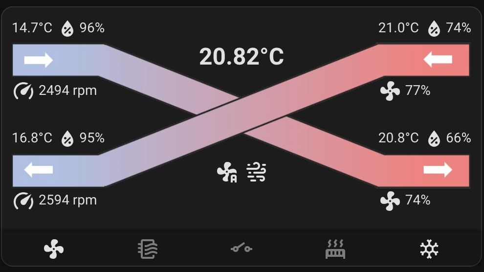

# Sabik for Home Assistant

[](https://my.home-assistant.io/redirect/hacs_repository/?owner=Arie&repository=ha-integration-sabik&category=integration)

A native Home Assistant integration for the S&P Sabik heat recovery unit (Sabik 350; other Sabik sizes with the same Modbus register map should work but are untested).

- Talks Modbus directly to the unit: over a USB/RS485 adapter on the Home Assistant host, or over the network through ser2net or an RS485 gateway.
- Needs no MQTT broker, no separate bridge and no YAML. Everything is set up in the UI.
- Ships the Sabik dashboard card, which registers itself: no separate HACS frontend install and no Lovelace resource.
- Replaces the [Ruby Modbus→MQTT bridge](https://github.com/Arie/sabik) and the [separate card](https://github.com/Arie/lovelace-sabik), with a one-click migration that keeps your entity IDs and history.

Requires Home Assistant **2026.10.4** or newer.



## Contents

1. [Hardware](#hardware)
2. [Install](#install)
3. [Configure](#configure)
4. [Entities](#entities)
5. [The Sabik card](#the-sabik-card)
6. [Migrating from the MQTT bridge](#migrating-from-the-mqtt-bridge)
7. [Troubleshooting](#troubleshooting)
8. [Known limitations](#known-limitations)

## Hardware

You need an RS485 connection to the unit's Modbus port:

- **USB/RS485 adapter** plugged into the machine that runs Home Assistant (an FTDI-based adapter works well), or
- the same adapter plugged into another machine (a Raspberry Pi, a server) running **ser2net**, or
- a cheap **RS485-to-WiFi/Ethernet gateway**.

The unit's factory settings are Modbus RTU, 19200 baud, 8 data bits, even parity, 1 stop bit (8E1), slave address 1. The integration's defaults match.

**Only one client can use the bus at a time.** If anything else talks to the unit (the old MQTT bridge, a test script), stop it before adding the integration.

## Install

1. Open HACS, open the menu (⋮) and choose **Custom repositories**. Add `https://github.com/Arie/ha-integration-sabik` with type **Integration**. Or click the badge at the top of this page.
2. Search for **Sabik** in HACS and **Download** it.
3. Restart Home Assistant.

## Configure

Go to **Settings → Devices & services → Add integration** and choose **Sabik**. You are asked how the unit is connected.

### USB / serial port

Pick the adapter from the list. Prefer the `/dev/serial/by-id/...` entry: unlike `/dev/ttyUSB0` it doesn't change when you plug in other USB devices. If no adapter is listed, type the path yourself.

**Advanced settings** (collapsed, defaults are right for a factory unit):

| Setting | Default | Notes |
|---|---|---|
| Slave address | 1 | 1–247, must match the unit |
| Baud rate | 19200 | 4800, 9600, 19200 or 38400 |
| Parity | Even | Even, Odd, or None (None uses 2 stop bits, as the unit expects) |
| Poll interval | 5 s | 2–60 s; a full read takes under a second |

### Network (host:port)

Enter the **Host** and **Port** of the gateway, and pick the **Protocol**:

- **Modbus RTU over TCP (raw gateway):** for ser2net in raw mode and for gateways that pass serial bytes through unchanged. This is what most cheap gateways do.
- **Modbus TCP:** only for gateways that convert to real Modbus TCP themselves.

Advanced settings: slave address and poll interval, as above.

#### ser2net example

On the machine with the adapter, install ser2net (`apt install ser2net`) and replace `/etc/ser2net.yaml` with a single raw connection:

```yaml
%YAML 1.1
---
connection: &sabik
  accepter: tcp,5020
  enable: on
  options:
    kickolduser: true
  connector: serialdev,/dev/serial/by-id/YOUR-ADAPTER,19200e81,local
```

- `accepter: tcp,5020` listens on port 5020 on all interfaces. To listen on one address only, use `tcp,192.0.2.10,5020`. Any free port works.
- Use a plain `tcp` accepter, not `telnet` or RFC2217, and don't add a `banner`: the integration expects raw Modbus bytes.
- ser2net only opens the adapter while a client is connected.
- The Debian package ships example connections on other ports; removing them (as above) avoids exposing ports you don't use.

Restart ser2net (`systemctl restart ser2net`), then add the integration with **Network**, the machine's address, port `5020` and **Modbus RTU over TCP**.

### Test read

Before saving, the integration reads one register from the unit. If that fails you see **"No response from the unit, check wiring and settings"** and can correct the settings. See [Troubleshooting](#troubleshooting).

### Changing settings later

There is no reconfigure option yet. To change the port, host or address, delete the Sabik entry and add it again. Entity IDs and history are kept, because the new entities get the same IDs.

## Entities

All entities belong to one device, **Sabik**.

**Main control**

| Entity | What it does |
|---|---|
| `fan.sabik` | On/off plus presets low, medium, high, auto and snooze. Off means snooze: the unit can't be switched off fully over Modbus. Use this for voice assistants and simple automations. |

**Controls**

| Entity | What it does |
|---|---|
| `select.sabik_fan_speed` | Low, medium, high or auto. Choosing a speed also leaves snooze. |
| `switch.sabik_boost` | Boost on/off (leaves snooze first). |
| `switch.sabik_snooze` | Snooze on/off. Turning snooze off resumes the previous mode. |
| `switch.sabik_manual_bypass` | Opens the bypass. Refused with a clear message when the temperatures don't allow it (outdoor and extract below their minimums, or the difference too small). |
| `switch.sabik_summer_mode` | Summer mode. Refused when the outdoor temperature is below the bypass minimum. |
| `switch.sabik_allow_automatic_bypass` | Lets the unit open the bypass by itself. |
| `switch.sabik_automatic_work_mode` | Automatic (sensor-driven) vs manual work mode. Either way it leaves snooze first. |
| `number.sabik_min_outdoor_temperature_for_bypass` | 12.0–20.0 °C |
| `number.sabik_min_extract_temperature_for_bypass` | 21.0–30.0 °C |
| `number.sabik_min_temperature_difference_for_bypass` | 3.0–6.0 °C |
| `number.sabik_manual_bypass_timer` | 1–8 h |
| `button.sabik_reset_filter_alarm` | Resets the filter alarm. |
| `button.sabik_sync_clock` | Sets the unit's clock to Home Assistant's local time. |

**Sensors**

- Temperatures: extract, exhaust, outdoor, supply air (`sensor.sabik_*_air_temperature`).
- Relative humidity per air stream (`sensor.sabik_rh_extract_air`, `_exhaust_air`, `_outdoor_air`, `_supply_air`).
- Motors: RPM and control voltage, extract and supply (`sensor.sabik_rpm_*_motor`, `sensor.sabik_voltage_*_motor`, 0–10 V).
- State: bypass valve position, current work mode, defrost status, selected air volume, and the three bypass thresholds.
- Diagnostic, disabled by default: communication error, unit clock.

**Binary sensors**

- Filter alarm, extract fan alarm, supply fan alarm, summer mode, boost status.
- Automatic bypass (the unit opened the bypass itself) and boost contact (a wired boost switch is closed).
- Diagnostic, disabled by default: active alarms, and a fault sensor per temperature sensor.

When the unit can't be reached, all entities become unavailable. The integration keeps retrying and recovers by itself.

Entity IDs are English on every Home Assistant language; friendly names follow your language (English and Dutch are included).

## The Sabik card

The card comes with the integration. There's nothing to install and no resource to add.

**Add it:** edit a dashboard, **Add card**, search for **Sabik**. In YAML dashboards `type: custom:sabik-card` works.

**Options**, all set in the visual editor:

| Option | Meaning |
|---|---|
| Device | Which Sabik unit. Only asked for when you have more than one. |
| Room temperature sensor | Optional. Shown at the top of the middle column. |
| Room humidity sensor | Optional. Shown under the room temperature. |

YAML equivalent:

```yaml
type: custom:sabik-card
room_temperature_entity: sensor.living_room_temperature
room_humidity_entity: sensor.living_room_humidity
```

The card's buttons use the integration's entities: the fan menu sets the fan speed, the icons toggle boost, snooze, bypass and summer mode. Bypass and summer mode are greyed out when the temperatures don't allow them. When the unit opened the bypass itself, the bypass tooltip says so, and a click turns on the manual bypass instead of doing nothing. Errors appear as a notification at the bottom of the screen.

## Migrating from the MQTT bridge

If you used the Ruby bridge ([Arie/sabik](https://github.com/Arie/sabik)) and the old card ([Arie/lovelace-sabik](https://github.com/Arie/lovelace-sabik)), the integration moves you over in one step. Your entity IDs stay the same, so dashboards, automations, history and long-term statistics keep working.

**What is carried over** from each old entity: its entity ID (also if you renamed it), name, icon, area, labels, voice-assistant aliases, Assist exposure, hidden or disabled state, and display precision or unit you set yourself. The old device's area and name are copied to the new Sabik device.

**What is not carried over:** the old `climate` entity ("Sabik Ventilation"). It had no real climate function; use `fan.sabik` instead.

### Steps

1. **Make a backup** (Settings → System → Backups).
2. **Stop and disable the bridge**, so it doesn't start again after a reboot:
   - Docker: `docker compose down` in the bridge folder.
   - systemd: `systemctl --user disable --now sabik-mqtt.service` (or whatever you named the service).
3. **Install and configure the integration** as described above. If the bridge had the adapter, use the same adapter path; or point the integration at ser2net.

   Right after setup you'll see the new entities with a `_2` suffix (for example `sensor.sabik_extract_air_temperature_2`), because the old MQTT entities still hold the original IDs. That's expected; the next step fixes it.
4. **Run the migration.** Go to **Settings → System → Repairs** and open **Migrate from the Sabik MQTT bridge**.
   - The first step checks that the bridge is really stopped. If it published anything in the last 30 seconds you get "The bridge still looks like it is running"; stop it, wait half a minute and try again.
   - The confirm step clears the bridge's MQTT discovery topics, removes the old MQTT entities and devices, and gives the new entities the old IDs.
   - The summary shows how many entities were renamed and removed, and lists any that couldn't be renamed.
5. **Remove the old card**, or it may load instead of the new one:
   - In HACS, uninstall **Sabik Card**.
   - In **Settings → Dashboards → ⋮ → Resources**, delete any remaining `sabik-card.js` resource (for example `/local/lovelace-sabik/sabik-card.js` if you installed it by hand).
   - If your resources are in YAML (`lovelace:` → `resources:` in `configuration.yaml`), that page can't edit them. Remove the `sabik-card.js` line from the YAML and restart Home Assistant.
   - If you installed the card by hand, you can delete the leftover `config/www/lovelace-sabik/` folder. Nothing loads it once the resource is gone.
   - Reload the dashboard with a hard refresh (Ctrl+Shift+R); in the companion app, use **Reload resources** or restart the app.
   - To check which card is loaded, edit a Sabik card. The new card opens a visual editor with the room sensor fields; the old card only offers YAML. If you still see the old one, a resource is left over.
6. **Set the room sensors on your cards.** The old card had the room temperature sensor hardcoded; the new one asks for it. Edit each Sabik card and pick the room temperature (and optionally humidity) sensor. An old `entity:` line on the card can be removed; it's not used.
7. **Update automations** that used the old climate entity (`climate.sabik_ventilation`, or `climate.sabik_ventilation_sabik_ventilation` depending on your setup) to use `fan.sabik`, `select.sabik_fan_speed` or the switches.

### What to expect afterwards

- Home Assistant's log shows a burst of recorder messages at the moment of migration, like *"Cannot rename statistic_id `sensor.sabik_..._2` … already in use"* and *"Cannot migrate history for entity_id …"*. These are harmless: they mean Home Assistant kept the existing history on the original IDs and dropped the few minutes of `_2` history.
- **Motor voltage** now reports real volts (0–10 V) instead of the raw 0–100 value, so its long-term statistics show one jump at the switch-over. The card still shows the motors as a percentage, as before.
- **Fan speed** shows *unknown* when the unit reports a value it doesn't map, instead of pretending it's *medium*.

### If the old MQTT entities come back

If MQTT wasn't running during the migration, the bridge's discovery topics couldn't be cleared and the summary says so. If the old `sabik` MQTT entities reappear later, restart Home Assistant and run the repair again. It's safe to run more than once.

## Troubleshooting

**"No response from the unit, check wiring and settings"**

- Make sure nothing else uses the adapter (the bridge, another integration, a script).
- Serial: check the adapter path, baud rate 19200, parity Even, slave address 1. Swap the RS485 A/B wires if you've never had a response.
- Network: check host and port, and that the protocol matches the gateway (ser2net raw → **Modbus RTU over TCP**). From another machine, `nc -vz HOST PORT` should connect.

**Entities are unavailable after it worked before.** The unit or the gateway stopped answering. The integration retries every poll interval and recovers by itself; the log shows one "Error fetching sabik data" line and a "Fetching sabik data recovered" line.

**The dashboard still shows the old card.** An old `sabik-card.js` resource is still loaded. See migration step 5.

**Debug logging.** The integration keeps pymodbus quiet during outages so the log doesn't fill up. For the integration's own debug messages, use Settings → Devices & services → Sabik → ⋮ → **Enable debug logging**. To also see pymodbus' low-level messages, set both loggers in `configuration.yaml` and restart Home Assistant:

```yaml
logger:
  logs:
    custom_components.sabik: debug
    pymodbus: debug
```

## Known limitations

- No reconfigure option yet: delete and re-add the entry to change connection settings.
- Week programs and other registers the old bridge didn't use aren't exposed.
- Silencing pymodbus applies to the whole process, so it also quiets Home Assistant's built-in Modbus integration if you use that too. Enabling debug logging from the UI later doesn't undo this; use the `configuration.yaml` example under [Troubleshooting](#troubleshooting).

## Credits

The card is based on [wichers/lovelace-comfoair](https://github.com/wichers/lovelace-comfoair). Released under the MIT license.
